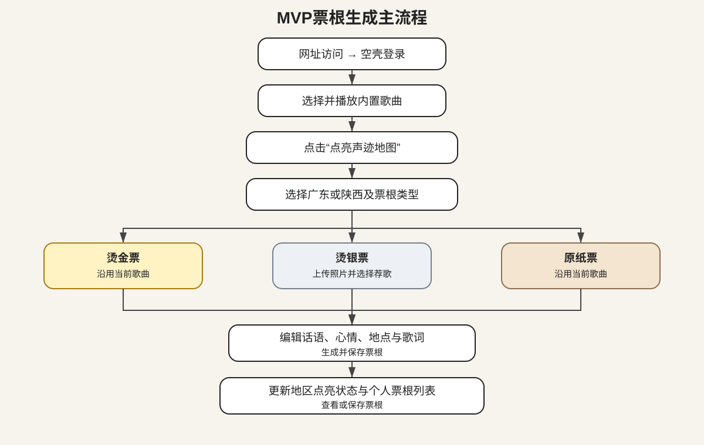
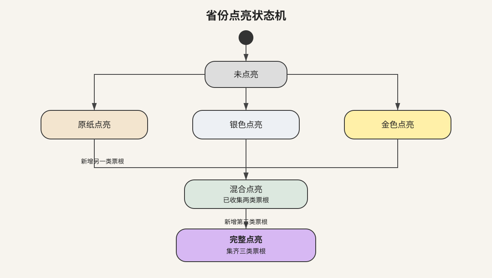
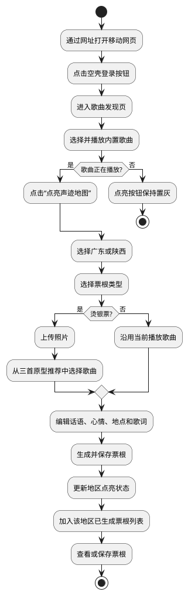
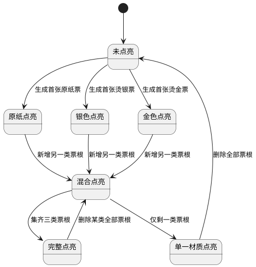

# 「寻声觅迹 ECHO TRAIL」移动网页端产品需求文档

> 文档版本：初赛 MVP V1.1  
> 项目类型：QQ音乐黑客松初赛原型  
> 产品形态：独立移动端网页  
> 核心范围：广东、陕西完整体验；其他省级地区占位  
> 更新日期：2026年9月25日

## 1. 项目背景

### 1.1 需求简介

搭建一个不依赖举办方接口的独立移动端网页原型。用户在网页内播放某首歌曲时点击“点亮声迹地图”，选择广东或陕西并制作不同材质的音乐票根，票根保存后自动点亮地图并进入对应地区的个人票根列表。

### 1.2 业务诉求

#### 1.2.1 用户价值

• 让用户用一首歌保存自己与某个地区相关的生活、旅行或想象。  
• 用烫金、烫银和原纸三种票根区分不同的歌曲与地区关系。  
• 用个人地图承载长期积累，避免票根成为一次性分享图片。  
• 用匿名原型数据展示地区音乐共鸣和音乐情绪地图的未来价值。

#### 1.2.2 初赛约束

• 举办方不提供登录、播放记录、曲库、歌词、定位、天气或分享接口。  
• 原型必须作为独立网页打开，不要求从QQ音乐客户端进入。  
• 以移动端体验为主，需支持通过公开网址快速部署和访问。  
• 登录仅制作界面空壳，不进行真实账号鉴权。  
• 歌曲、歌词、榜单、共鸣人数、天气和推荐结果均使用原型内置演示数据。  
• 用户新生成的票根仅在当前原型中保存，不与QQ音乐账号同步。

### 1.3 产品定位

「寻声觅迹 ECHO TRAIL」是一款以音乐票根为记录单位的地域音乐记忆网页。“寻声”代表寻找与地域、照片和心情契合的音乐，“觅迹”代表用票根保存旅途印记并点亮地图；“ECHO TRAIL”对应声音回响与不断延伸的旅程足迹。

品牌主标语为：“寻一段声，留一处迹。”

产品说明为：“用音乐票根记录旅途，让每一首歌点亮一方山河。”

### 1.4 MVP范围

#### 1.4.1 本期包含

• 独立移动端网页及空壳登录页。  
• 内置歌曲列表和歌曲播放页。  
• 播放状态下的“点亮声迹地图”入口。  
• 广东、陕西均支持烫金票、烫银票和原纸票。  
• 票根话语、心情、具体地点、照片和歌词编辑。  
• 广东、陕西个人已生成票根列表。  
• 中国省级地区地图及点亮状态。  
• 广东、陕西音乐情绪地图和地区共鸣演示。  
• 其他省级地区灰色占位。

#### 1.4.2 本期不包含

• 真实QQ音乐登录及任何举办方接口。  
• 真实曲库搜索、真实播放历史和账号同步。  
• 自动定位、天气接口和旅行轨迹。  
• 省份音乐歌单。  
• 好友关系共创、共同票根和公开票根社区。  
• 本地生活者与旅行者的选择差异。  
• “你是今天第几位记录者”等实时顺序文案。  
• 广东、陕西以外地区的票根制作和详情页。

### 1.5 目标用户与核心场景

#### 1.5.1 目标用户

• 喜欢用音乐记录旅行和生活瞬间的用户。  
• 愿意制作、收藏或分享个性化音乐卡片的年轻用户。  
• 对广东、陕西的地域音乐与情绪表达感兴趣的用户。

#### 1.5.2 核心场景

• 用户正在网页播放一首歌，想用它记录广东或陕西。  
• 用户希望上传一张广东或陕西照片，并为照片生成烫银票。  
• 用户未到访某地，但希望用当前歌曲表达对广东或陕西的印象。  
• 用户希望查看自己在广东和陕西已经制作的全部票根。  
• 用户希望通过演示数据了解某首歌在一个地区产生的群体共鸣。

### 1.6 MVP目标

• 无需任何外部业务接口即可完成部署和现场演示。  
• 跑通“播放歌曲—点亮声迹地图—制作票根—点亮地区—查看票根”的闭环。  
• 广东和陕西均可独立完成三类票根制作。  
• 刷新或重新打开同一浏览器后，用户已生成票根仍可回看。  
• 所有原型数据均有明确标识，不冒充真实QQ音乐线上数据。

## 2. 业务流程简述

### 2.1 首次访问流程

1. 用户通过网址打开移动端网页。  
2. 页面展示空壳登录页。  
3. 用户点击“开启寻声之旅”。  
4. 系统以固定演示身份进入歌曲发现页，不进行账号验证。

### 2.2 票根生成主流程

1. 用户在歌曲发现页选择一首内置歌曲。  
2. 用户进入歌曲播放页并点击播放。  
3. 歌曲处于播放状态时，“点亮声迹地图”按钮进入可点击状态。  
4. 用户点击按钮，当前歌曲信息被带入票根制作页。  
5. 用户选择广东或陕西。  
6. 用户选择烫金、烫银或原纸票。  
7. 用户补充对应票种信息并编辑话语、心情、地点、照片和歌词。  
8. 用户生成票根，系统自动更新地图和该地区的已生成票根列表。  
9. 用户查看、保存图片或返回继续制作。

### 2.3 三类票根规则

| 票根类型 | 表达含义 | MVP必要条件 | 地图效果 |
| --- | --- | --- | --- |
| 烫金·在场聆听票 | 我在这里听见 | 当前歌曲正在播放，用户选择广东或陕西 | 对应地区显示金色点亮 |
| 烫银·旅途影像票 | 我在这里看见 | 上传照片并选择广东或陕西，可沿用或更换推荐歌曲 | 对应地区显示银色点亮 |
| 原纸·地域印象票 | 我如何记得或想象这里 | 当前歌曲与广东或陕西 | 对应地区显示原纸色点亮 |

### 2.4 地区点亮规则

• 同一地区可以生成多张同类票根。  
• 仅拥有一种票根时，地图显示对应材质。  
• 拥有两种票根时，地图显示融合材质并标记“已收集2/3”。  
• 集齐三种票根时，地图显示“完整点亮”。  
• 删除某类全部票根后，地图按剩余票种重新计算。  
• 删除该地区全部票根后，地区恢复未点亮。

## 3. 详细功能需求说明

### 3.1 空壳登录页

• 位置：用户首次打开网页时展示。  
• 目标：保留完整产品入口观感，但不接入真实登录服务。

#### 3.1.1 界面元素与展示规则

• 页面展示产品标识、中文名“寻声觅迹”、英文名“ECHO TRAIL”和主标语“寻一段声，留一处迹”。  
• 主按钮固定显示“开启寻声之旅”。  
• 页面底部显示说明：“初赛演示版本，无需真实账号登录。”  
• 不展示手机号、验证码、账号密码或第三方授权表单。

#### 3.1.2 交互逻辑与状态流转

• 初始化条件：用户首次访问或主动退出演示。  
• 默认态：主按钮高亮可点击。  
• 触发指令：用户点击“开启寻声之旅”。  
• 执行中：按钮显示“正在进入”，执行五百毫秒防重复点击。  
• 执行异常：页面资源未加载完成时提示“资源加载失败，请刷新重试”。  
• 执行成功：进入歌曲发现页，并记录已进入演示状态。

#### 3.1.3 异常与系统边界

• 登录页不校验任何身份，不得向用户暗示已登录QQ音乐账号。  
• 清除浏览器数据后，演示身份和已生成票根均可被清空。  
• 不存储手机号、QQ号或其他真实身份信息。

### 3.2 歌曲发现页

• 位置：空壳登录页之后。  
• 目标：提供无需曲库接口即可进入播放页的歌曲入口。

#### 3.2.1 界面元素与展示规则

• 顶部展示“今日推荐”，下方展示内置歌曲卡片列表。  
• 每张卡片显示封面、歌名、歌手和一句场景描述。  
• 首屏建议内置六至八首演示歌曲，广东与陕西相关歌曲各不少于三首。  
• 歌名最多两行，歌手名单行截断并在末尾显示“...”。  
• 页面底部导航包含“听歌”“地图”“我的票根”。

#### 3.2.2 交互逻辑与状态流转

• 初始化条件：内置歌曲数据加载完成。  
• 默认态：列表按预设顺序展示，不进行个性化推荐。  
• 触发指令：用户点击歌曲卡片。  
• 执行中：卡片显示按压反馈，防止连续跳转。  
• 执行异常：歌曲资源不可用时提示“演示歌曲暂不可播放”。  
• 执行成功：进入歌曲播放页并带入歌曲信息。

#### 3.2.3 异常与系统边界

• MVP不提供全曲库搜索。  
• 所有音频、封面和歌词仅使用团队有权用于演示的素材。  
• 无可播放歌曲时展示“暂无演示歌曲”，地图和已生成票根仍可访问。

### 3.3 歌曲播放页与点亮入口

• 位置：用户点击歌曲卡片后进入。  
• 目标：以正在播放的歌曲作为票根制作起点。

#### 3.3.1 界面元素与展示规则

• 页面展示封面、歌名、歌手、播放进度、播放或暂停按钮及演示歌词。  
• 页面底部固定展示主按钮“点亮声迹地图”。  
• 歌曲未播放时按钮置灰，并显示辅助文案“播放歌曲后即可点亮”。  
• 歌曲开始播放后按钮高亮。  
• 页面切到后台导致音频暂停时，按钮同步恢复置灰。

#### 3.3.2 交互逻辑与状态流转

• 初始化条件：歌曲详情与音频资源可用。  
• 默认态：歌曲暂停，“点亮声迹地图”不可点击。  
• 触发指令：用户点击播放按钮。  
• 执行中：音频加载时播放按钮展示加载动画。  
• 执行异常：播放失败时提示“歌曲加载失败，请重试”，点亮按钮保持不可点击。  
• 执行成功：歌曲进入播放状态，点亮按钮高亮；用户点击后进入票根制作页，并携带当前歌曲。  
• 返回播放页后，若歌曲仍处于播放状态，点亮按钮保持可点击。

#### 3.3.3 异常与系统边界

• MVP不校验实际播放时长，成功进入播放状态即可点亮。  
• 当前歌曲已制作过票根时仍允许重复制作。  
• 浏览器禁止自动播放时，由用户手动点击播放，不弹出额外权限说明。  
• 播放其他歌曲时，票根制作入口携带最新的当前歌曲。

### 3.4 票根制作首页

• 位置：歌曲播放页点击“点亮声迹地图”后进入。  
• 目标：选择地区和票种，并确认本次票根使用的歌曲。

#### 3.4.1 界面元素与展示规则

• 顶部展示当前歌曲迷你播放卡片。  
• 地区选择仅提供“广东”和“陕西”。  
• 票种展示“烫金·在场聆听”“烫银·旅途影像”“原纸·地域印象”三张卡片。  
• 三种票根在广东和陕西均可选择，不设置地区专属票种。  
• 未完成地区与票种选择时，“下一步”按钮置灰。

#### 3.4.2 交互逻辑与状态流转

• 初始化条件：页面已接收到当前歌曲。  
• 默认态：地区和票种均未选择。  
• 触发指令：用户依次选择地区和票种，点击“下一步”。  
• 执行中：按钮显示“正在准备票面”，执行五百毫秒防重复点击。  
• 执行异常：当前歌曲信息缺失时提示“歌曲信息已失效，请返回重新播放”。  
• 执行成功：烫金票和原纸票直接进入编辑页；烫银票进入照片荐歌页。

#### 3.4.3 异常与系统边界

• 用户返回播放页后，已选择的地区与票种不保留。  
• MVP不读取真实位置，烫金票的地区由用户主动选择。  
• 页面需标注“初赛版本由用户确认所在地区”。

### 3.5 烫银票照片荐歌

• 位置：用户选择烫银票后进入。  
• 目标：通过照片与预设氛围规则演示照片荐歌体验。

#### 3.5.1 界面元素与展示规则

• 上传区支持从相册选择一张照片或调用相机拍摄。  
• 页面展示已选择地区，不自动识别照片地理位置。  
• 上传后展示三首内置候选歌曲及简短推荐理由。  
• 当前播放歌曲默认作为第一候选，用户可保留当前歌曲或更换为其他候选。  
• 推荐区域固定标注“原型推荐结果”。

#### 3.5.2 交互逻辑与状态流转

• 初始化条件：用户已选择广东或陕西及烫银票。  
• 默认态：上传区显示“添加一张旅途照片”。  
• 触发指令：用户上传照片。  
• 执行中：展示“正在匹配照片氛围”，持续时间不超过两秒。  
• 执行异常：照片读取失败时保留地区选择，提供“重新上传”。  
• 执行成功：显示三首候选歌曲；用户选择后点击“制作这张票”，进入票根编辑页。

#### 3.5.3 异常与系统边界

• MVP不调用图像识别或在线AI接口，推荐结果来自内置演示规则。  
• 不进行人脸身份识别。  
• 用户拒绝相册权限时提示“请允许读取照片后再试”，并允许返回选择其他票种。  
• 图片仅用于当前票根预览和本地保存，不上传外部服务。

### 3.6 票根编辑与生成

• 位置：烫金票或原纸票确认后，或烫银票完成照片荐歌后进入。  
• 目标：完成票根个性化编辑、生成和保存。

#### 3.6.1 界面元素与展示规则

• 固定字段包括票种、地区、歌曲、歌手、生成日期和票号。  
• 可编辑字段包括一句话、心情标签、具体地点、照片和歌词。  
• 一句话最多六十个汉字，票面最多展示三行，达到上限后禁止继续输入。  
• 心情标签最多选择三个，使用预设标签，不开放自由输入。  
• 具体地点最多二十个汉字，可留空。  
• 歌词区从当前歌曲的内置歌词中随机展示三句，支持“换一批”和“不展示歌词”。  
• 内置歌词不足三句时展示全部可用歌词。  
• 烫金票展示金属反光效果，烫银票展示银色扫光效果，原纸票展示纸张纹理。

#### 3.6.2 交互逻辑与状态流转

• 初始化条件：地区、票种和歌曲信息完整。  
• 默认态：票面实时预览，输入框不自动聚焦。  
• 触发指令：用户点击“生成票根”。  
• 执行中：按钮显示“正在印制”，不可重复点击。  
• 执行异常：保存失败时保留全部编辑内容，并提示“票根生成失败，请重试”。  
• 执行成功：进入票根成功页，更新对应地区点亮状态，并将票根加入该地区列表。

#### 3.6.3 异常与系统边界

• 页面刷新或意外关闭前，编辑内容自动保存为草稿。  
• 用户重新进入时询问“是否继续上次编辑”，点击遮罩不得关闭该确认弹窗。  
• 同一操作重复提交时只能生成一张票根。  
• 演示歌词不得超出演示素材的使用权限。

### 3.7 票根成功页

• 位置：票根生成完成后进入。  
• 目标：呈现完整票根、地区点亮反馈和地区共鸣。

#### 3.7.1 界面元素与展示规则

• 页面居中展示完整票根。  
• 点亮反馈显示“广东已点亮”或“陕西已点亮”。  
• 地区共鸣标准文案为：“已有{人数}位音乐旅人在{地区名}点亮过这首歌。”  
• 共鸣人数为内置原型数据，旁边固定标注“演示数据”。  
• 页面提供“保存图片”“查看我的票根”“继续听歌”三个操作。

#### 3.7.2 交互逻辑与状态流转

• 保存图片首次请求相册权限，成功后提示“已保存到相册”。  
• 点击“查看我的票根”进入当前地区的票根列表。  
• 点击“继续听歌”返回歌曲发现页。  
• 保存失败时保留票根，提示用户截图保存。

#### 3.7.3 明确禁止文案

• 不使用“你与这些人共同听过”。  
• 不使用“此刻有多少人正在听”。  
• 不使用“你是今天第几位记录者”。  
• 不将演示共鸣人数描述为QQ音乐真实线上数据。

### 3.8 声迹地图首页

• 位置：底部导航“地图”。  
• 目标：展示个人地区点亮状态，并提供广东、陕西详情入口。

#### 3.8.1 界面元素与展示规则

• 地图展示中国省级地区轮廓。  
• 广东和陕西根据用户已生成票根展示原纸、银色、金色或完整点亮效果。  
• 其他地区统一为灰色占位，不开放票根制作。  
• 地图下方显示“已点亮{地区数}个地区，收藏{票根数}张票根”。  
• 无票根时显示“还没有点亮记录，去播放一首歌吧”。

#### 3.8.2 交互逻辑与状态流转

• 点击广东或陕西进入对应地区详情页。  
• 点击其他地区显示轻提示“初赛版本暂未开放该地区”。  
• 地图数据读取中展示轮廓骨架屏。  
• 数据读取失败时展示“地图加载失败，点击重试”。

#### 3.8.3 异常与系统边界

• 地图状态以当前浏览器中已保存的有效票根为准。  
• 清除浏览器数据后地图恢复初始状态。  
• MVP不跨设备同步地图和票根。

### 3.9 广东与陕西地区详情页

• 位置：地图点击广东或陕西后进入。  
• 目标：展示该地区三种票根入口状态、个人已生成票根和音乐情绪演示数据。

#### 3.9.1 界面元素与展示规则

• 顶部展示地区名称、点亮材质和“已收集{票种数}/3”。  
• 三种票根区域分别展示数量；无对应票根时显示“尚未收集”。  
• “我的票根”区域展示当前地区全部已生成票根。  
• “音乐情绪地图”展示本周最多人点亮的歌、今日地区主题曲、雨天歌曲、深夜歌曲、旅行者歌曲和本周心情标签。  
• 所有音乐情绪内容固定标注“原型演示数据”。  
• 广东和陕西使用相同页面结构与完整能力，不设置功能差异。

#### 3.9.2 已生成票根列表

• 默认按生成时间倒序展示。  
• 支持按“全部、烫金、烫银、原纸”筛选。  
• 每张卡片展示票根缩略图、歌曲、票种和生成日期。  
• 歌名最多两行，超出后尾部显示“...”。  
• 无票根时显示“还没有留下票根，播放一首歌开始记录”。  
• MVP预计票根数量较少，一次加载全部数据，不提供分页。

#### 3.9.3 交互逻辑与状态流转

• 点击票根卡片进入票根详情。  
• 点击音乐情绪歌曲进入对应内置歌曲播放页；无对应演示音频时按钮不可点击。  
• 点击“继续点亮”返回歌曲发现页，不直接在详情页创建票根。  
• 数据为空或读取失败时，不影响地区演示数据展示。

### 3.10 票根详情与删除

• 位置：地区详情页点击个人票根后进入。  
• 目标：支持回看、保存和删除个人票根。

#### 3.10.1 界面元素与展示规则

• 完整展示票面。  
• 页面底部提供“保存图片”和“删除票根”。  
• 票根数据不存在时显示“这张票根已不存在”，并提供返回地图按钮。

#### 3.10.2 交互逻辑与状态流转

• 点击删除后展示确认弹窗：“删除后将重新计算该地区的点亮状态，是否继续？”  
• 弹窗使用半透明遮罩，点击遮罩不关闭。  
• 确认后进入删除中状态，成功后返回地区详情并刷新列表与地图。  
• 删除失败时关闭加载状态，保留票根并提示重试。

#### 3.10.3 异常与系统边界

• 删除仅影响当前浏览器中的个人票根。  
• 原型共鸣人数和音乐情绪演示数据不因个人删除而变化。  
• 清除浏览器数据等同于删除全部个人票根，无法恢复。

### 3.11 移动网页适配与部署边界

• 位置：全局。  
• 目标：保证原型能够通过网址快速部署，并在主流移动浏览器中完成核心流程。

#### 3.11.1 适配规则

• 页面以竖屏移动端为主，核心内容宽度适配常见手机屏幕。  
• 横屏时提示“建议竖屏体验”，但不强制阻断。  
• 所有主要按钮可触区域不小于四十四像素。  
• 票根预览在小屏设备上整体等比缩放，不横向滚动。  
• 尊重系统减少动态效果设置，关闭材质扫光动画但保留静态视觉。

#### 3.11.2 无网与弱网降级

• 首次访问必须联网加载网页资源。  
• 页面加载完成后，已生成票根优先读取本地保存数据。  
• 音频资源加载失败时禁止进入票根制作主流程，并允许用户重试。  
• 图片保存失败时提供截图兜底。  
• 不因统计演示数据加载失败阻断播放、票根制作或地图回看。

## 4. 流程与状态图表

### 4.1 MVP票根生成主流程

### 4.2 地区点亮状态机

## 5. 数据口径与验收标准

### 5.1 MVP数据分类

• 内置歌曲数据：原型预先配置的歌曲、封面、音频、歌词和场景描述。  
• 原型演示数据：地区榜单、共鸣人数、天气歌曲和心情标签分布。  
• 用户生成数据：用户在当前浏览器中制作的票根、照片、话语、心情和点亮状态。  
• 草稿数据：用户尚未完成生成的票根编辑内容。

### 5.2 核心验收标准

• 用户可从独立网址打开移动网页，无需进入QQ音乐。  
• 点击空壳登录按钮后可直接进入产品，不产生真实登录请求。  
• 歌曲未播放时“点亮声迹地图”不可点击，播放后可以进入制作页。  
• 广东和陕西均能分别生成烫金、烫银和原纸三种票根。  
• 用户可编辑话语、心情、地点、照片和随机歌词。  
• 生成票根后，对应地区地图状态和已生成票根列表立即更新。  
• 广东和陕西详情页均能筛选并查看三类已生成票根。  
• 其他省级地区仅显示灰色占位，点击后提示暂未开放。  
• 页面中不出现省份歌单、本地与旅行者差异或“今日第几位”文案。  
• 所有共鸣、榜单和推荐模拟结果均明确标注为原型演示数据。  
• 刷新网页后，同一浏览器中已生成的票根仍然存在。  
• 在主流移动浏览器中可完成全部核心流程。

### 5.3 初赛建议观察指标

• 从歌曲播放到点击“点亮声迹地图”的转化率。  
• 进入制作页到票根生成成功的完成率。  
• 三种票根的生成占比。  
• 广东与陕西的点亮占比。  
• 票根保存图片率。  
• 用户查看地区详情与已生成票根列表的比例。

## 6. 风险与依赖

### 6.1 MVP依赖

• 依赖可公开部署的网页托管环境。  
• 依赖团队可合法用于演示的音频、封面、歌词和照片素材。  
• 依赖移动浏览器的音频播放、相册读取和图片保存能力。  
• 不依赖QQ音乐账号、曲库、播放记录、歌词、定位、天气或分享API。

### 6.2 核心风险

• 演示歌曲过少导致体验重复：准备覆盖广东与陕西不同气质的六至八首歌曲。  
• 用户误以为数据来自QQ音乐：所有榜单、共鸣和推荐结果持续标注“原型演示数据”。  
• 浏览器限制自动播放：所有音频均由用户主动点击播放。  
• 浏览器本地数据被清除：在页面内说明初赛版本不支持云端恢复。  
• 图片体积导致网页卡顿：上传后以票面展示所需尺寸进行处理。  
• 歌词版权风险：仅使用有权演示的歌词素材，或使用原创占位歌词。  
• MVP被误解为最终实现方案：路演明确说明正式版本将接入真实播放记录、曲库与地域数据。

## 7. 附录

### 7.1 MVP票根生成主流程源码

### 7.2 地区点亮状态机源码

